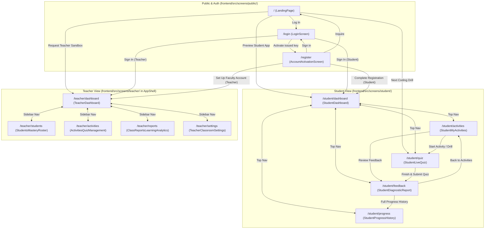

# NAVIGATION.md — Screen Navigation & Backend API Route Map

> Complete reference mapping all **13 Aralytics screens**, their frontend URL routes, outgoing UI navigation links, and planned backend REST API endpoints (`/api/public/*`, `/api/auth/*`, `/api/student/*`, `/api/teacher/*`).

---

## 1. Visual Navigation Graph

---

## 2. Frontend Routes ↔ Backend API Endpoints Matrix

### 2.1 Public & Authentication Routes

| Frontend Route | Screen Component | Stitch Source | Planned Backend API Endpoints | Purpose |
|---|---|---|---|---|
| `/` | `frontend/src/screens/public/LandingPage.jsx` | `screens/stitch/landing_page/code.html` | `POST /api/public/pilot-inquiry` | Submit school/classroom pilot inquiry form |
| `/login` | `frontend/src/screens/public/LoginScreen.jsx` | `screens/stitch/aralytics_login/code.html` | `POST /api/auth/login` `POST /api/auth/logout` `GET /api/auth/me` | Authenticate Student or Teacher credentials and return session/JWT + role |
| `/register` | `frontend/src/screens/public/AccountActivationScreen.jsx` | `screens/stitch/aralytics_account_registration_activation/code.html` | `POST /api/auth/verify-key` `POST /api/auth/activate` | Validate school code (`STJUDE-MNL-2025`) + access key (`KEY-8821-PY` / `FAC-2025-DEPED`) and set password |

---

### 2.2 Student View Routes (`/student/*` ↔ `/api/student/*`)

| Frontend Route | Screen Component | Stitch Source | Planned Backend API Endpoints | Purpose |
|---|---|---|---|---|
| `/student/dashboard` | `frontend/src/screens/student/StudentDashboard.jsx` | `screens/stitch/portal/code.html` | `GET /api/student/dashboard` `PATCH /api/student/preferences` | Fetch student greeting, streak/XP stats, active quiz card, learning path, AI coaching tips, and badges |
| `/student/activities` | `frontend/src/screens/student/StudentMyActivities.jsx` | `screens/stitch/aralytics_student_my_activities/code.html` | `GET /api/student/activities?category=all\|assigned\|remedial\|completed` `POST /api/student/office-hours/book` | List assigned, remedial, and completed coding activities; book 15-min teacher consultation slot |
| `/student/quiz` | `frontend/src/screens/student/StudentLiveQuiz.jsx` | `screens/stitch/aralytics_student_live_quiz_code_scenario/code.html` | `GET /api/student/quiz/:quizId` `PATCH /api/student/quiz/:quizId/answer` `POST /api/student/quiz/:quizId/flag` `POST /api/student/quiz/:quizId/submit` | Load 10-question code debugging scenario, save selected option A–D, flag questions, and submit quiz for AI evaluation |
| `/student/feedback` | `frontend/src/screens/student/StudentDiagnosticReport.jsx` | `screens/stitch/aralytics_instant_ai_feedback_diagnostic_report/code.html` | `GET /api/student/feedback/:submissionId` `POST /api/student/feedback/:submissionId/practice-drill` `GET /api/student/feedback/:submissionId/pdf` | Fetch 80% evaluation score, root-cause analysis, question review breakdown, submit 3-item remedial drill (`+15 XP`), download PDF |
| `/student/progress` | `frontend/src/screens/student/StudentProgressHistory.jsx` | `screens/stitch/aralytics_student_feedback_history_progress/code.html` | `GET /api/student/progress` `GET /api/student/progress/history?filter=all\|needs-practice\|mastered&q=...` `GET /api/student/progress/report/:reportId` `POST /api/student/progress/notes` | Fetch mastery trajectory, competency bars, searchable AI feedback history, modal diagnostic report, and student pinned notes |

---

### 2.3 Teacher View Routes (`/teacher/*` ↔ `/api/teacher/*`)

All Teacher View screens are wrapped in `AppShell` (`Sidebar.jsx` + `TopBar.jsx`).

| Frontend Route | Screen Component | Stitch Source | Planned Backend API Endpoints | Purpose |
|---|---|---|---|---|
| `/teacher/dashboard` | `frontend/src/screens/teacher/TeacherDashboard.jsx` | `screens/stitch/aralytics_teacher_desktop_dashboard/code.html` | `GET /api/teacher/dashboard?section=10-Rizal&concept=All` `POST /api/teacher/diagnostics/run` `GET /api/teacher/students/:studentId/diagnostic` `POST /api/teacher/students/:studentId/nudge` `GET /api/teacher/dashboard/export-csv` | Fetch cohort KPIs, mastery trajectory chart/table, flagged students, student drilldown modal (EN/FIL), and student directory |
| `/teacher/students` | `frontend/src/screens/teacher/StudentsMasteryRoster.jsx` | `screens/stitch/aralytics_students_mastery_roster/code.html` | `GET /api/teacher/students?search=...&topic=...&status=...&page=1` `GET /api/teacher/students/:studentId` `PUT /api/teacher/students/:studentId/private-log` `POST /api/teacher/students/batch-nudge` | Paginated student mastery roster, right-hand student deep-dive drawer, private teacher notes log, and batch nudge |
| `/teacher/activities` | `frontend/src/screens/teacher/ActivitiesQuizManagement.jsx` | `screens/stitch/aralytics_activities_quiz_management/code.html` | `GET /api/teacher/activities?status=...&topic=...` `POST /api/teacher/activities` `PATCH /api/teacher/activities/:activityId` `POST /api/teacher/activities/ai-generate` | List coding activities & quizzes, filter by status/topic, create new activity via slide-over drawer, push remedial drills |
| `/teacher/reports` | `frontend/src/screens/teacher/ClassReportsLearningAnalytics.jsx` | `screens/stitch/reports/code.html` | `GET /api/teacher/reports?term=...&section=...` `GET /api/teacher/reports/export-csv` `GET /api/teacher/reports/export-pdf` | Cohort mastery distribution, DepEd MELCs competency matrix, misconception clusters, AI telemetry, and CSV/PDF exports |
| `/teacher/settings` | `frontend/src/screens/teacher/TeacherClassroomSettings.jsx` | `screens/stitch/teacher_settings/code.html` | `GET /api/teacher/settings` `PUT /api/teacher/settings` | Read and update AI diagnostic tone (`Taglish`, `Formal English`, `Conversational Filipino`), remedial threshold slider, profile, and grading weights |

---

## 3. Screen-by-Screen Navigation Details

### 3.1 Public & Auth Screens (`frontend/src/screens/public/`)

1. **`/` (`LandingPage.jsx`)**
   - Header Brand Logo → `/`
   - Header / Mobile Drawer `Log In` → `/login`
   - Header `Start Free Classroom Pilot` → `#pilot-signup`
   - Hero `Next Coding Drill` → `/student/quiz`
   - Product Preview Tab (`For Students`): `Preview Student Coding App` / `Simulan Na →` → `/student/dashboard`
   - Product Preview Tab (`For CS Teachers`): `Request Teacher CS Sandbox` / `Push Drill` → `/teacher/dashboard`
   - Footer links → `/teacher/dashboard`, `/student/dashboard`, `/student/quiz`

2. **`/login` (`LoginScreen.jsx`)**
   - Header Brand Logo → `/`
   - Role Switcher (`Student` vs `Teacher / Educator`) → Pre-fills default credentials (`miguel@school.edu.ph` / `maria.santos@university.edu.ph`)
   - Submit (`Sign In to Aralytics`) → `/student/dashboard` (when `role === 'student'`) or `/teacher/dashboard` (when `role === 'teacher'`)
   - `Activate issued account / key` → `/register`

3. **`/register` (`AccountActivationScreen.jsx`)**
   - Header Brand Logo → `/`
   - Submit (`Complete Registration & Sign In` / `Set Up Faculty Account`) → `/student/dashboard` (when `role === 'student'`) or `/teacher/dashboard` (when `role === 'educator'`)
   - `Inquire` → `/#pilot-signup`
   - `Sign in` → `/login`

---

### 3.2 Student View Screens (`frontend/src/screens/student/`)

All 5 Student View screens include a top navigation bar (plus responsive `xl:hidden` mobile hamburger drawer) wired to:
- **Dashboard / Brand Logo** → `/student/dashboard`
- **My Activities / Quizzes** → `/student/activities`
- **Live Quiz / Code Scenario** → `/student/quiz`
- **AI Feedback / Diagnostic Report** → `/student/feedback`
- **My Progress & Skills** → `/student/progress`
- **Sign Out / Logout** → `/login`

Additional in-screen CTAs:
- **`/student/dashboard`**:
  - `Quick Drill`, `Start Quiz Now`, and Learning Path `Start` buttons → `/student/quiz`
  - `Preview Details`, `View All Completed Drills →` → `/student/activities`
  - `Practice While Loops (5m)`, `View All Feedback` → `/student/feedback`
  - `View CS Skill Matrix`, `All Badges →` → `/student/progress`
- **`/student/activities`**:
  - Urgent banner `Go to Assessment`, `Start Activity`, `Start Remedial Drill`, `View Details` → `/student/quiz`
  - Completed card `Review Feedback` → `/student/feedback`
  - `Preview Syllabus`, `Q2 Target`, `65% Complete` → `/student/progress`
- **`/student/quiz`**:
  - `Save & Exit` → `/student/activities`
  - `Finish & Submit Quiz` → `/student/feedback`
- **`/student/feedback`**:
  - `Practice Similar Questions (3 Items)` → Opens interactive Practice Drill Modal (`+15 XP` on completion)
  - `Back to My Activities` → `/student/activities`
  - `View Full Progress History` → `/student/progress`
- **`/student/progress`**:
  - `Start AI Practice Drill`, `Practice 3 Similar Questions`, `Start 5-Min Trace Drill` → `/student/quiz`
  - `View Full Diagnostic Report` → Opens Diagnostic Report Modal (`loops` / `trace`)

---

### 3.3 Teacher View Screens (`frontend/src/screens/teacher/`)

All 5 Teacher View screens share `AppShell.jsx`:
- **Left `Sidebar.jsx` navigation**:
  - Brand Logo (`Aralytics`) → `/`
  - `Dashboard` → `/teacher/dashboard`
  - `Students` → `/teacher/students`
  - `Activities` → `/teacher/activities`
  - `Reports` → `/teacher/reports`
  - `Settings` → `/teacher/settings`
  - Profile Footer (`G. Santos` logout button) → `/login`
- **Top `TopBar.jsx` actions**:
  - `New Activity` CTA button → `/teacher/activities`

---

## 4. Legacy Route Redirects (`frontend/src/App.jsx`)

For backwards compatibility with older bookmarks, `frontend/src/App.jsx` automatically redirects:

| Legacy Path | Redirects To |
|---|---|
| `/home` | `/student/dashboard` |
| `/student` | `/student/dashboard` |
| `/student/diagnostic-report` | `/student/feedback` |
| `/teacher` | `/teacher/dashboard` |
| `/dashboard` | `/teacher/dashboard` |
| `/students` | `/teacher/students` |
| `/activities` | `/teacher/activities` |
| `/reports` | `/teacher/reports` |
| `/settings` | `/teacher/settings` |
