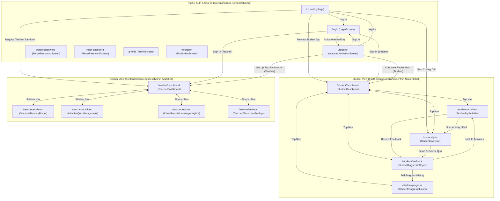

# NAVIGATION.md — Screen Navigation & Backend API Route Map

> Complete reference mapping Aralytics screens, their frontend URL routes, outgoing UI navigation links, and backend REST API endpoints (`/api/public/*`, `/api/auth/*`, `/api/student/*`, `/api/teacher/*`). Endpoints marked `(501)` are intentionally deferred post-MVP; see [`../backend/README.md`](../backend/README.md) for the authoritative API contract.

---

## 1. Visual Navigation Graph

---

## 2. Frontend Routes ↔ Backend API Endpoints Matrix

### 2.1 Public, Authentication & Shared Routes

| Frontend Route | Screen Component | Stitch Source | Backend API Endpoints | Purpose |
|---|---|---|---|---|
| `/` | `frontend/src/screens/public/LandingPage.jsx` | `screens/stitch/landing_page/code.html` | `POST /api/public/pilot-inquiry` | Submit and persist school/classroom pilot inquiry |
| `/login` | `frontend/src/screens/public/LoginScreen.jsx` | `screens/stitch/aralytics_login/code.html` | `POST /api/auth/login` `POST /api/auth/logout` `GET /api/auth/me` | Authenticate Student or Teacher credentials and return stateless JWT + role |
| `/register` | `frontend/src/screens/public/AccountActivationScreen.jsx` | `screens/stitch/aralytics_account_registration_activation/code.html` | `POST /api/auth/verify-key` `POST /api/auth/activate` | Validate school code + access key and activate account |
| `/forgot-password` | `frontend/src/screens/public/ForgotPasswordScreen.jsx` | — | `POST /api/auth/forgot-password` | Request a short-lived password-reset token/email |
| `/reset-password` | `frontend/src/screens/public/ResetPasswordScreen.jsx` | — | `POST /api/auth/reset-password` | Consume reset token and set a new password |
| `/forbidden` | `frontend/src/screens/shared/ForbiddenScreen.jsx` | — | — *(client-side RBAC guard)* | Render 403 access-denied view on role-mismatched routes |
| `/profile` | `frontend/src/screens/shared/ProfileScreen.jsx` | — | `GET /api/auth/profile` `PUT /api/auth/profile` `PUT /api/auth/profile/password` | View/update user profile details and change password |

---

### 2.2 Student View Routes (`/student/*` ↔ `/api/student/*`)

| Frontend Route | Screen Component | Stitch Source | Backend API Endpoints | Purpose |
|---|---|---|---|---|
| `/student/dashboard` | `frontend/src/screens/student/StudentDashboard.jsx` | `screens/stitch/portal/code.html` | `GET /api/student/dashboard` `GET /api/student/notifications` | Fetch student counts, streak, recent scores, concept mastery, and notifications |
| `/student/activities` | `frontend/src/screens/student/StudentMyActivities.jsx` | `screens/stitch/aralytics_student_my_activities/code.html` | `GET /api/student/activities?category=all\|assigned\|remedial\|completed` | List published, remedial, and completed coding activities |
| `/student/quiz` | `frontend/src/screens/student/StudentLiveQuiz.jsx` | `screens/stitch/aralytics_student_live_quiz_code_scenario/code.html` | `GET /api/student/quiz/{quizId}` `PATCH /api/student/quiz/{quizId}/answer` `POST /api/student/quiz/{quizId}/submit` | Load published quiz (no `correctAnswer`), save durable drafts (`QUIZ_DRAFT`), and submit for scoring + diagnostic feedback |
| `/student/feedback` | `frontend/src/screens/student/StudentDiagnosticReport.jsx` | `screens/stitch/aralytics_instant_ai_feedback_diagnostic_report/code.html` | `GET /api/student/feedback/{submissionId}` `POST /api/student/feedback/{submissionId}/retry` `POST /api/student/feedback/{submissionId}/practice-drill` | Read owner-only diagnostic feedback (`200` READY / `202` PENDING), retry generation, or generate a 3-question practice drill |
| `/student/progress` | `frontend/src/screens/student/StudentProgressHistory.jsx` | `screens/stitch/aralytics_student_feedback_history_progress/code.html` | `GET /api/student/progress` `GET /api/student/progress/history?search=...` | Fetch concept mastery and searchable past submission/feedback history |

---

### 2.3 Teacher View Routes (`/teacher/*` ↔ `/api/teacher/*`)

All Teacher View screens are wrapped in `AppShell` (`Sidebar.jsx` + `TopBar.jsx`).

| Frontend Route | Screen Component | Stitch Source | Backend API Endpoints | Purpose |
|---|---|---|---|---|
| `/teacher/dashboard` | `frontend/src/screens/teacher/TeacherDashboard.jsx` | `screens/stitch/aralytics_teacher_desktop_dashboard/code.html` | `GET /api/teacher/dashboard?section=&concept=` `GET /api/teacher/notifications` `GET /api/teacher/students/{studentId}/diagnostic` `POST /api/teacher/diagnostics/run` *(501)* `POST /api/teacher/students/{studentId}/nudge` *(501)* `GET /api/teacher/dashboard/export-csv` *(501)* | Fetch cohort KPIs, mastery overview, flagged students, student drilldown, and notifications |
| `/teacher/students` | `frontend/src/screens/teacher/StudentsMasteryRoster.jsx` | `screens/stitch/aralytics_students_mastery_roster/code.html` | `GET /api/teacher/students?search=&topic=&status=&page=1&size=20` `GET /api/teacher/students/{studentId}` `PUT /api/teacher/students/{studentId}/private-log` *(501)* `POST /api/teacher/students/batch-nudge` *(501)* | Paginated student mastery roster and student deep-dive drawer |
| `/teacher/activities` | `frontend/src/screens/teacher/ActivitiesQuizManagement.jsx` | `screens/stitch/aralytics_activities_quiz_management/code.html` | `GET /api/teacher/activities?status=&topic=` `POST /api/teacher/activities` `PATCH /api/teacher/activities/{activityId}` `POST /api/teacher/activities/{activityId}/publish` `POST /api/teacher/activities/ai-generate` *(501)* | List, create, edit DRAFT activities, and publish to enrolled students |
| `/teacher/reports` | `frontend/src/screens/teacher/ClassReportsLearningAnalytics.jsx` | `screens/stitch/reports/code.html` | `GET /api/teacher/reports/export-csv?topic=` `GET /api/teacher/reports/export-pdf?section=&topic=` | Download roster CSV and cohort analytics PDF exports |
| `/teacher/settings` | `frontend/src/screens/teacher/TeacherClassroomSettings.jsx` | `screens/stitch/teacher_settings/code.html` | `GET /api/teacher/settings` `PUT /api/teacher/settings` | Read and persist intervention threshold and feedback tone settings |

---

## 3. Screen-by-Screen Navigation Details

### 3.1 Public & Auth Screens (`frontend/src/screens/public/`)

1. **`/` (`LandingPage.jsx`)**
   - Header Brand Logo → `/`
   - Header / Mobile Drawer `Log In` → `/login`
   - Header `Request School Pilot` → `#pilot-signup`
   - Hero `Activate School Key` → `/register`
   - Hero `Explore Live Demo` → Interactive walkthrough modal (links to `/login` and `#pilot-signup`)
   - Interactive Sample Classroom Preview (Option A/B/C Python loop-bounds diagnostic with live Aral Coach hint)
   - Ecosystem WAI-ARIA tabs (`For Students` / `For CS Teachers`) → `/login`

2. **`/login` (`LoginScreen.jsx`)**
   - Header Brand Logo → `/`
   - Role Switcher (`Student` vs `Teacher / Educator`) → Pre-fills default dev credentials (`miguel@school.edu.ph` / `maria.santos@university.edu.ph`) when `ENV=development`
   - Submit (`Sign In to Aralytics`) → `/student/dashboard` or `/teacher/dashboard` based on backend-returned role
   - `Forgot password?` → `/forgot-password`
   - `Activate issued account / key` → `/register`

3. **`/register` (`AccountActivationScreen.jsx`)**
   - Header Brand Logo → `/`
   - Submit (`Complete Registration & Sign In` / `Set Up Faculty Account`) → `/student/dashboard` (when `role === 'student'`) or `/teacher/dashboard` (when `role === 'educator'`)
   - `Inquire` → `/#pilot-signup`
   - `Sign in` → `/login`

---

### 3.2 Student View Screens (`frontend/src/screens/student/`)

All 5 Student View screens share `StudentShell.jsx` (`frontend/src/components/layout/StudentShell.jsx`), providing horizontal navigation from `lg+` (`1024px+`) and a `<lg` mobile drawer:
- **Brand Logo / `Home`** → `/student/dashboard`
- **`Activities`** → `/student/activities`
- **`Quiz`** → `/student/quiz`
- **`Feedback`** → `/student/feedback`
- **`Progress`** → `/student/progress`
- **Profile `Avatar`** → `/profile`
- **Sign Out** → `/login`

Additional in-screen CTAs:
- **`/student/dashboard`**:
  - `Quick Drill`, `Start Quiz Now` → `/student/quiz`
  - `View Activities` → `/student/activities`
  - `Open Diagnostic Report` → `/student/feedback`
  - `View Progress History` → `/student/progress`
- **`/student/activities`**:
  - `Start Quiz` / `Continue` → `/student/quiz`
  - `View Diagnostic Report` → `/student/feedback`
- **`/student/quiz`**:
  - `Browse My Activities` → `/student/activities`
  - `Submit` / `View AI Feedback` → `/student/feedback`
- **`/student/feedback`**:
  - `View Quiz` → `/student/quiz`
  - `View Progress & Feedback History` → `/student/progress`
  - `Start Practice Drill` → Renders 3-question drill inline
- **`/student/progress`**:
  - `View Report` → `/student/feedback`

---

### 3.3 Teacher View Screens (`frontend/src/screens/teacher/`)

All 5 Teacher View screens share `AppShell` in `frontend/src/App.jsx`:
- **Left `Sidebar.jsx` navigation**:
  - Brand Logo (`Aralytics`) → `/`
  - `Dashboard` → `/teacher/dashboard`
  - `Students` → `/teacher/students`
  - `Activities` → `/teacher/activities`
  - `Reports` → `/teacher/reports`
  - `Settings` → `/teacher/settings`
  - Profile Footer (`Maria Santos` / `Avatar`) → `/profile` (Sign Out → `/login`)
- **Top `TopBar.jsx` actions**:
  - Stored class pill (`getStoredClasses()`)
  - `NotificationBell`
  - `New Activity` CTA button → `/teacher/activities`
  - Profile `Avatar` → `/profile`

---

## 4. Legacy Route Redirects (`frontend/src/App.jsx`)

For backwards compatibility with older bookmarks, `frontend/src/App.jsx` automatically redirects:

| Legacy Path | Redirects To |
|---|---|
| `/home` | `/student/dashboard` |
| `/student` | `/student/dashboard` |
| `/student/diagnostic-report` | `/student/feedback` |
| `/teacher` | `/teacher/dashboard` |
| `/dashboard` | `/teacher/dashboard` |
| `/students` | `/teacher/students` |
| `/activities` | `/teacher/activities` |
| `/reports` | `/teacher/reports` |
| `/settings` | `/teacher/settings` |
